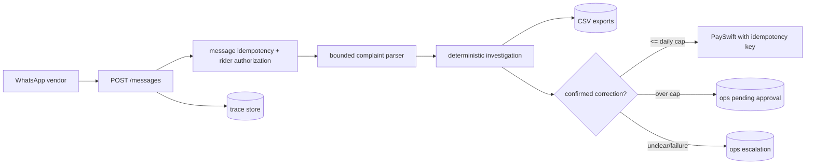

# QuickDrop Rider Payout Dispute Desk

An auditable, deterministic service for resolving QuickDrop rider payout complaints. It accepts the messaging vendor contract, keeps idempotent conversation traces, checks the supplied trip/payout exports, reconciles corrections against PaySwift, and queues anything requiring ops review.

## Run

Local Python 3.11+: `python -m venv .venv && . .venv/bin/activate && pip install -r requirements.txt && uvicorn app.main:app --reload`. Set `PAYSWIFT_BASE_URL` (default `http://localhost:8081`); `.env.example` lists all variables. With Docker: `docker compose up --build`.

Run tests with `pytest -q`. Run the evaluator against a running service with `python evals/run.py http://localhost:8000`.

## Design



The parser only extracts dates, order IDs, and complaint signals. It never decides ownership, amounts, approval, or payment. `calculator.py` implements the policy using Decimal/half-up rounding, handles known malformed distance exports, compares source payout lines, and emits evidence. `agent.py` enforces the ₹200-per-rider-per-day PaySwift cap, never pays more than the confirmed shortfall, and treats untrusted instructions as data. SQLite stores traces, message deduplication, and pending work; the compose stack also starts Postgres for deployment parity and future migration.

Endpoints: `GET /health`, `POST /messages`, `GET /trace/{rider_id}`, `GET /ops/pending`, and the lightweight ops page `GET /ops`; ops decisions use `POST /ops/pending/{id}` with `{"decision":"approved"}` or `rejected`. Example request:

```json
{"message_id":"wamid.demo","rider_id":"R003","text":"order T926334 ka surge nahi mila","received_at":"2026-09-22T09:05:00+05:30"}
```

The response contains `{"reply":"..."}`. Ops pending items contain approval amounts or escalation reasons. Every inbound message, parsed decision, investigation tool call, and outbound reply is traceable without logging secrets.

## Assumptions and limitations

The supplied CSV exports are the local system of record for historical reconciliation; PaySwift is the authority for newly issued corrections. No paid LLM is required: this deliberately narrow parser is reliable for the provided evaluation vocabulary and is replaceable behind `parse_complaint` if a production classifier is introduced. Postgres is provisioned by Compose, while the current implementation uses SQLite to keep the take-home self-contained. The evaluator script is a smoke/content report; financial assertions are covered in unit tests and should be expanded with a live PaySwift integration harness.

## AI session logs

`ai-logs/` contains the assignment-provided instructions only. Genuine raw Codex session exports were not automatically available to this workspace; before submission, export the actual session JSONL from the Codex session directory and place it there. Do not fabricate logs or include secrets.

## Submission

This directory is separate from the cloned read-only reference at `../original-assignment`. Create a private GitHub repository, add this directory as its contents, push `main`, then add `Sarthak-pyard` as a collaborator only after explicitly authorizing that GitHub action. Do not make the repository public.
