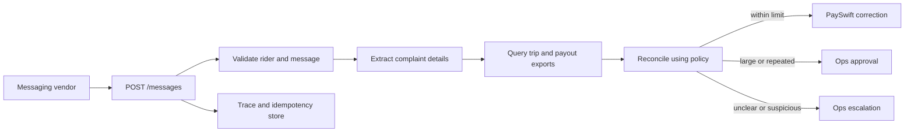

# QuickDrop Rider Payout Desk

QuickDrop receives rider messages about missing or incorrect payouts. This service checks each complaint against trip and payout exports, calculates the correct amount using the payout policy, pays small verified corrections through PaySwift, and sends larger or unclear cases to operations.

The design is deliberately conservative. The message parser extracts dates, order IDs, and complaint signals; it cannot approve payments or invent financial facts. Authorization, calculations, payment limits, and escalation decisions are handled by Python code.

## Features

- Handles the messaging vendor's `POST /messages` contract.
- Preserves conversation context and ignores duplicate message deliveries.
- Prevents a rider from accessing another rider's orders.
- Checks trip status, distance, surge, incentives, cancellation penalties, and payout lines.
- Calculates corrections with Decimal and half-up rounding.
- Pays up to ₹200 per rider per day through PaySwift.
- Queues larger corrections and uncertain cases for operations.
- Provides audit traces and a small operations page at `/ops`.

## Request flow



The parser does not determine how much money is owed. `calculator.py` owns the business rules, and `payswift.py` owns external payment calls.

## API

```http
POST /messages
Content-Type: application/json
```

```json
{
  "message_id": "wamid.demo",
  "rider_id": "R003",
  "text": "order T926334 ka surge nahi mila",
  "received_at": "2026-09-22T09:05:00+05:30"
}
```

The response is `{"reply":"..."}`. Other endpoints are:

- `GET /health` — readiness check.
- `GET /trace/{rider_id}` — ordered messages, decisions, tool calls, and replies.
- `GET /ops/pending` — pending approvals and escalations as JSON.
- `GET /ops` — simple operations view.
- `POST /ops/pending/{id}` — approve or reject a pending item.

## Run locally

Python 3.11+ is recommended.

```bash
python -m venv .venv
source .venv/bin/activate
pip install -r requirements.txt
uvicorn app.main:app --reload
```

Configuration is read from environment variables listed in `.env.example`. `PAYSWIFT_BASE_URL` defaults to `http://localhost:8081`.

## Run with Docker

```bash
docker compose up --build
```

This starts the application, the PaySwift sandbox, and Postgres. The application is available at `http://localhost:8000`.

## Tests and evaluation

```bash
pytest -q
python evals/run.py http://localhost:8000
```

The tests cover policy calculations, incentives, authorization, prompt-injection handling, and idempotency. The supplied 24 conversation examples were also checked against their expected payout and approval totals.

## Project structure

```text
app/       service, workflow, parser, calculations, PaySwift client, and storage
data/      assignment exports and sample conversations
docs/      payout policy
evals/     interface-level evaluator
tests/     automated tests
payswift/  unchanged assignment sandbox
```

## Design decisions and limitations

The service does not require a paid LLM. This keeps the business-critical path deterministic and the tests repeatable. A model could be added behind `parser.py`, but it should remain limited to extracting structured complaint details and should never authorize tools or payments.

CSV exports are used for historical reconciliation, while PaySwift is the authority for newly issued corrections. SQLite keeps this take-home self-contained; Postgres is included in Compose for a straightforward future migration.

The operations page has no authentication. A production deployment would put it behind the company's identity provider and role-based access control. The parser is tuned to the supplied English/Hinglish examples rather than being a general multilingual model.

## AI session records

`ai-logs/` is reserved for genuine raw session exports. No conversations or tool logs are fabricated. Export the actual Codex session JSONL into that directory before submission if required by the assignment.

## Submission

The original assignment repository was kept separate and unchanged. Keep this GitHub repository private as required by the assignment and add `Sarthak-pyard` as a collaborator only when ready to submit.
